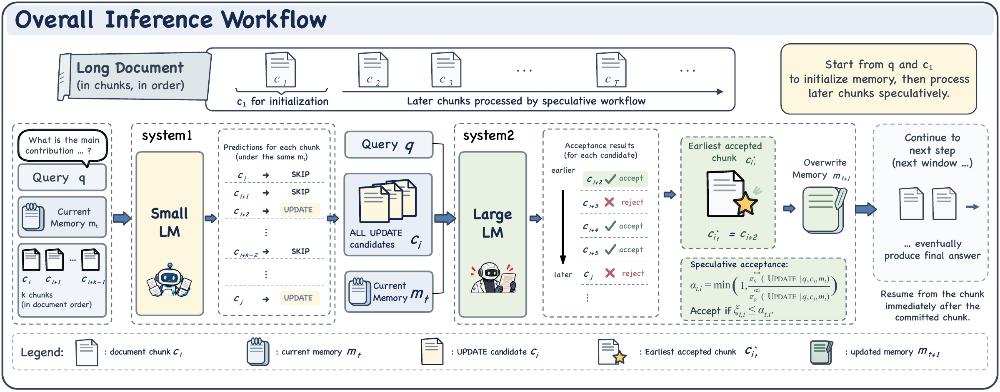

#  MemDuet

**Learning Dual-Process Memory for Long-Context Reasoning**

[English](README.md) · [简体中文](README.zh-CN.md)

[Project page](https://jiangchengsong.github.io/MemDuet/) · [arXiv](https://arxiv.org/abs/2610.19928) · [Paper PDF](https://arxiv.org/pdf/2610.19928) · [BibTeX](docs/assets/memduet.bib)

Jiangcheng Song, Haodong Jing, Yulin Mu, Lesong Tao, Jixin Wang, Jin Cui, Tianjing Ren, Runxuan Xie, Yongqiang Ma, Nanning Zheng

MemDuet pairs a small model that selects evidence in parallel with a large model that verifies and updates bounded memory in document order.

## Method



- **System 1:** parallel evidence selection from context chunks. Main backbone: Qwen3.5-2B. Evaluated variants: Qwen2.5-0.5B, Qwen2.5-1.5B, and Qwen3.5-0.8B.
- **System 2 (7B):** verification and ordered memory updates.
- **Training:** supervised selection, reinforcement learning for verification and rewriting, and joint optimization.

## Results

MemDuet reaches **84.20% mean RULER-HQA accuracy** across nine shared context lengths from 7K to 1.75M tokens. The 3.5M result is reported separately. The project page contains the full length-by-length table and original manuscript figures.

Across evaluation settings on RULER-HQA, LongBench v2, and 2WikiMultiHopQA, the paper reports **9.74× inference speedup** and **73.91% fewer output tokens** relative to RL-MemAgent.

## Resources

The inference implementation is available in [`src/memduet`](src/memduet), including vLLM clients, verified memory updates, checkpoint export, and resumable evaluation. Model weights and datasets are distributed separately; the MemDuet checkpoint download links are still being prepared.

## Example configuration

[`configs/inference.example.json`](configs/inference.example.json) pairs a **frozen Stage I Qwen3.5-2B system1** with **our final MemDuet-7B system2 checkpoint from the three-stage training pipeline**. Place the complete models in `system1` and `system2`, respectively.

After installing the environment below, place each complete inference model, including its tokenizer and chat template, in its configured directory. For system2, use the final MemDuet checkpoint. If it is supplied as a Stage III adapter, merge it with its matching trained Stage II backbone first. Then check the configured model paths:

```bash
python -m memduet validate --config configs/inference.example.json --check-paths
```

This example loads already merged models directly. Start the services in separate terminals, waiting for each to become ready:

```bash
# Terminal 1: final MemDuet system2 and verifier.
CUDA_VISIBLE_DEVICES=0 python -m memduet serve --config configs/inference.example.json --role system2

# Terminal 2: frozen Stage I system1, after the system2 is ready.
CUDA_VISIBLE_DEVICES=0 python -m memduet serve --config configs/inference.example.json --role system1

# Terminal 3: prepared RULER-HQA records for one context length.
python -m memduet evaluate --config configs/inference.example.json \
  --input data/ruler_hqa/112k.jsonl --output runs/eval/ruler_hqa_112k.json \
  --metric sub_em
python -m memduet summarize --results runs/eval/ruler_hqa_112k.json \
  --expected-ids configs/splits/paper_ruler_hqa.ids.json --strict
```

Prepare the same [128 source-question IDs](configs/splits/paper_ruler_hqa.ids.json) at each RULER-HQA length. Preserve the released benchmark's `source_id` as the canonical record `id`; row numbers and HotpotQA IDs use different namespaces. The input files and weights are supplied separately. Use `--metric choice` for prepared LongBench v2 questions and `--metric sub_em` for 2WikiMultihopQA.

## Inference quickstart

The following default configuration supports separately supplied trained adapters. For complete inference models, use `configs/inference.example.json` and the commands above.

Use Linux with an NVIDIA GPU for vLLM serving. The default deployment targets a single A100 80GB: both services share GPU 0, with GPU memory budgets of 65% for the system2 and 25% for the system1. Questions run sequentially; up to four candidate chunks from the current question run concurrently. Adjust the configuration to fit your hardware.

```bash
git clone https://github.com/jiangchengsong/MemDuet.git
cd MemDuet
python3.12 -m venv .venv
source .venv/bin/activate
python -m pip install -e '.[inference,serve,export]' -c requirements-lock.txt
python -m memduet --help
```

`requirements-lock.txt` pins the dependencies for vLLM inference. Package imports do not require vLLM or a model download.

### Supply trained checkpoints

Edit [`configs/inference.json`](configs/inference.json) to match your weights. The defaults expect a trained Qwen3.5-2B system1 adapter in `checkpoints/system1`, and a trained system2 adapter in `checkpoints/system2` with its matching full backbone in `checkpoints/system2/backbone`. The base system1 model is `Qwen/Qwen3.5-2B`.

These paths are relative to the repository root. The checkpoints are not bundled in this repository, and base models alone do not reproduce the paper results. With adapters available, export standalone serving models:

```bash
python -m memduet export-inference --config configs/inference.json
```

This writes `models/memduet-system1` and `models/memduet-system2`, including tokenizers. Export refuses to overwrite an existing destination. If you already have merged checkpoints, set `inference.system1.model_path` and `inference.system2.model_path` to their directories and skip export.

### Start the model services

Run the system2 first, then wait for it to report that it is ready before starting the system1 in a second terminal. Activate the same environment in both terminals.

```bash
# Terminal 1: system2 and verifier.
CUDA_VISIBLE_DEVICES=0 python -m memduet serve --role system2

# Terminal 2: system1.
CUDA_VISIBLE_DEVICES=0 python -m memduet serve --role system1
```

The default endpoints bind only to `127.0.0.1`, on ports 8000 and 8001. Model paths, endpoints, tensor parallelism, and memory budgets are configurable. Stop each owned service with Ctrl+C in its terminal.

### Run inference and evaluate

Supply your own JSONL records with `id`, `question`, `answers`, and either `context` or a nonempty `chunks` list. `answers` contains reference answers for scoring. JSON arrays using `input`, `context`, and `answers` are also accepted. For example, a synthetic input record has this format:

```json
{"id":"example","question":"Which city hosted the duet?","answers":["Xi'an"],"chunks":["The duet took place in Xi'an.","Both performers returned for an encore."]}
```

Save your records to `data/eval.jsonl`, then run:

```bash
python -m memduet validate --check-paths
python -m memduet evaluate --input data/eval.jsonl --output runs/eval/memduet.json
```

Defaults: seed 42, 5,000-token context chunks, a four-chunk window, 1,024-token memory and answer generation, and greedy text generation. The system1 samples UPDATE with probability `q(u)`; the system2 verifies it with acceptance probability `min(1, p(u)/q(u))`. The earliest accepted candidate updates memory, and the remaining suffix is reconsidered with that memory. All input chunks are retained.

For deterministic candidate selection, add `--selection-mode threshold --decision-delta -3`. The verifier still uses the acceptance probability. RULER-HQA and 2Wiki use the default `--metric sub_em`; LongBench v2 uses `--metric choice`.

Reports contain per-question answers, routing traces, latency, and output tokens from both models, including verification and discarded candidates. The default error policy stops on request failures or fallback trajectories. Repeating the same command resumes completed questions only when input and configuration match. Missing token usage remains unavailable rather than becoming zero.

Code license: [Apache-2.0](LICENSE). Third-party notices are retained in [NOTICE](NOTICE). Model and dataset licenses apply separately.

## Citation

```bibtex
@misc{song2026memduet,
  title  = {MemDuet: Learning Dual-Process Memory for Long-Context Reasoning},
  author = {Song, Jiangcheng and Jing, Haodong and Mu, Yulin and
            Tao, Lesong and Wang, Jixin and Cui, Jin and Ren, Tianjing and
            Xie, Runxuan and Ma, Yongqiang and Zheng, Nanning},
  year   = {2026},
  eprint = {2610.19928},
  archivePrefix = {arXiv},
  primaryClass = {cs.CL},
  url    = {https://arxiv.org/abs/2610.19928}
}
```

Published as [arXiv:2610.19928](https://arxiv.org/abs/2610.19928) [cs.CL].

## Website

The static project page is in `docs/` and is served by GitHub Pages from the `main` branch. Preview locally with:

```bash
python3 -m http.server 8765 --bind 127.0.0.1 --directory docs
```

Then open http://127.0.0.1:8765/.
